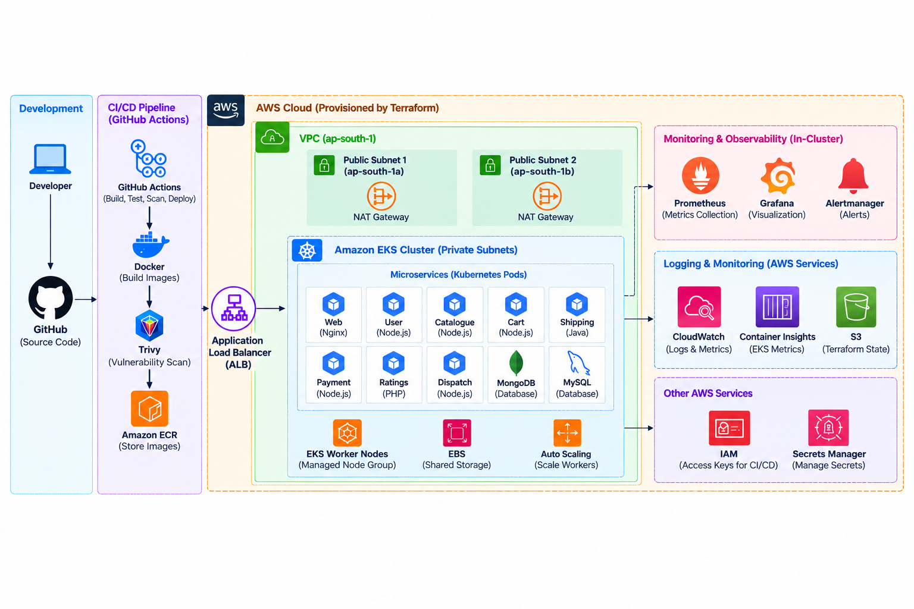
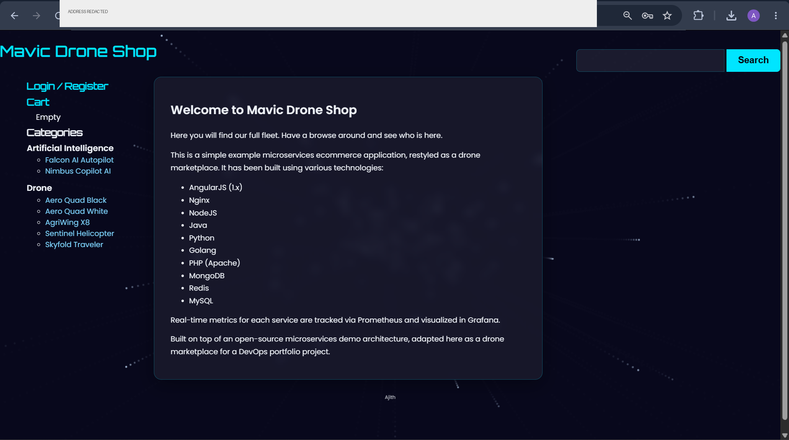
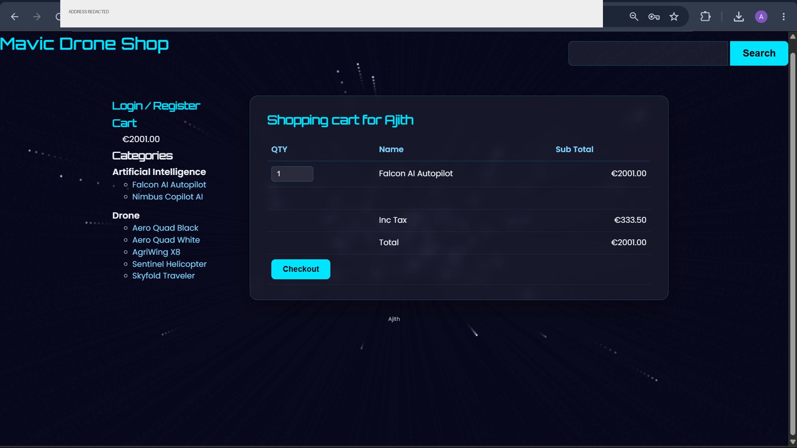
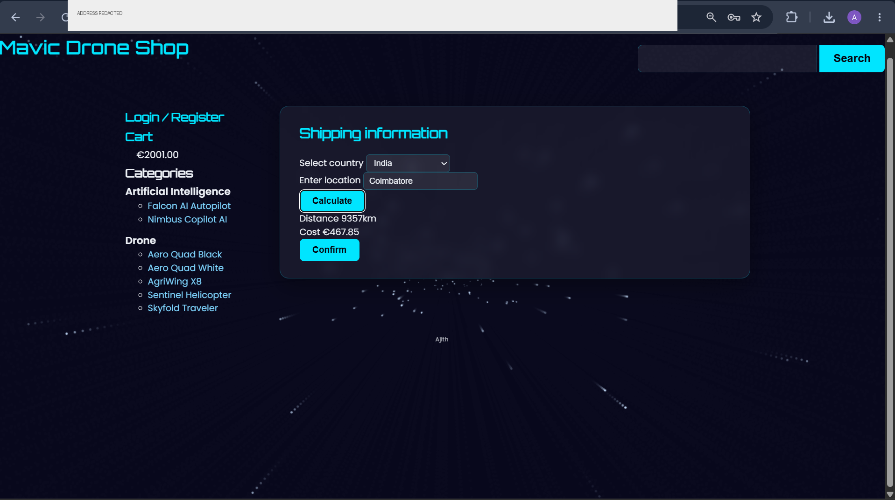
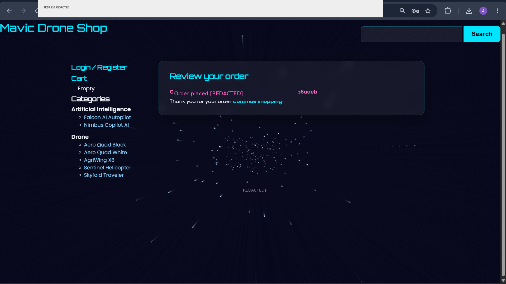
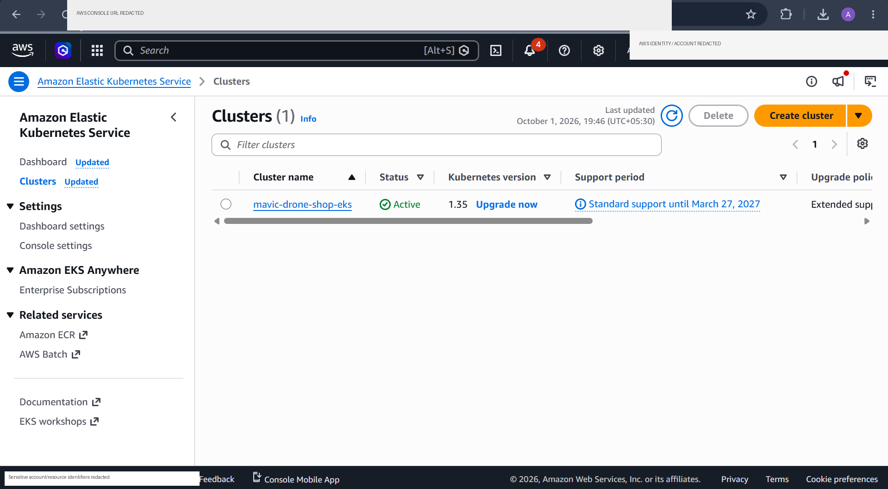
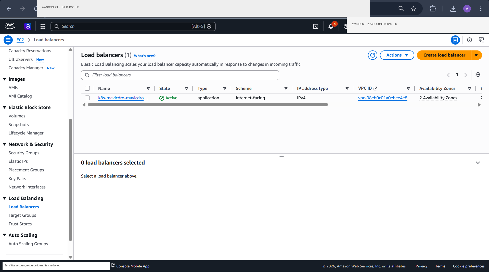
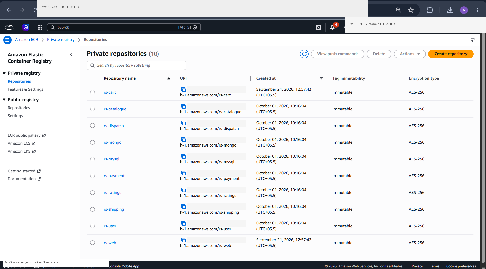
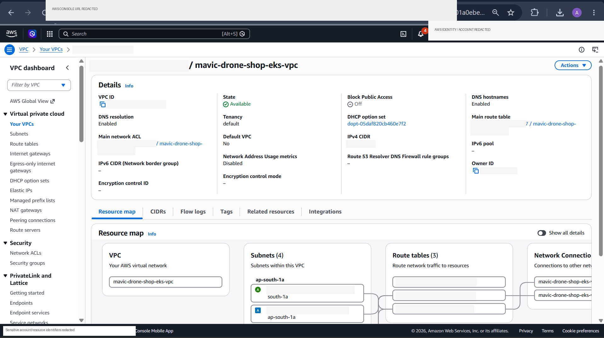

# Mavic Drone Shop — DevOps Portfolio on AWS EKS

> **An end-to-end DevOps implementation for a containerized microservices e-commerce application, covering local development, containerization, AWS infrastructure as code, CI/CD, Kubernetes delivery, ingress, security scanning and observability.**

<p align="center">
  
</p>

<p align="center">
  <b>Code → Build → Scan → Registry → Provision → Deploy → Expose → Observe</b>
</p>

---

## Why this repository exists

This project is intentionally more than an application deployment.

The application provides the workload; the repository demonstrates the **engineering platform around that workload**:

- repeatable AWS infrastructure with Terraform
- containerized services with Docker
- selective CI builds based on changed services
- vulnerability scanning with Trivy
- versioned container images in Amazon ECR
- Kubernetes deployment through reusable Helm charts
- AWS Application Load Balancer integration
- Prometheus metrics, Grafana dashboards and Alertmanager
- repeatable operational and validation commands

The goal is to demonstrate how a DevOps engineer takes software from a developer workstation to a monitored Kubernetes workload on AWS.

> **Public repository hygiene:** runtime credentials are supplied through environment variables, Terraform variables, GitHub Secrets, or Kubernetes Secrets. Evidence screenshots are sanitized to remove account IDs, resource IDs, hostnames, IP addresses, and local workstation identity.

---

## Platform at a glance

| Capability | Implementation |
|---|---|
| Application model | 8 stateless microservices + supporting data/messaging services |
| Local runtime | Docker Compose |
| Container platform | Docker |
| Container registry | Amazon ECR |
| Infrastructure as Code | Terraform |
| Cloud platform | Amazon EKS |
| Kubernetes packaging | Helm |
| External access | AWS Load Balancer Controller + ALB |
| CI | GitHub Actions |
| Image security | Trivy + ECR scan-on-push |
| Metrics | Prometheus |
| Visualization | Grafana |
| Alerting | Alertmanager |
| Validation | Kubernetes rollout checks + monitoring verification |
| AWS region | `ap-south-1` |

---

# 1. Architecture

The architecture below is the primary visual reference for the repository. It is built from the **actual Terraform/Helm configuration and the supplied screenshots**. The screenshots embedded in the diagram are real evidence from the working environment, sanitized for public GitHub; no dashboard, application screen, or AWS console view has been fabricated.


### Runtime flow

```text
Internet
   │
   ▼
AWS Application Load Balancer
   │
   ▼
web / Nginx
   │
   ├── catalogue ──► MongoDB
   ├── user ──────► MongoDB / Redis
   ├── cart ───────► Redis / catalogue
   ├── shipping ──► MySQL / cart
   ├── ratings ───► MySQL / catalogue
   └── payment ───► cart / user / RabbitMQ
                                  │
                                  ▼
                               dispatch
```

### Delivery flow

```text
Developer
   │
   ▼
GitHub
   │
   ▼
GitHub Actions
   ├── detect changed services
   ├── build Docker image
   ├── scan image with Trivy
   └── push Git-SHA image
              │
              ▼
         Amazon ECR
              │
              ▼
      Controlled CD workflow
              │
              ▼
             Helm
              │
              ▼
          Amazon EKS
```

### Observability flow

```text
Application metrics
        │
        ▼
 ServiceMonitor
        │
        ▼
   Prometheus
      ├──► Grafana
      └──► Alertmanager
```

**Detailed architecture:** [`docs/ARCHITECTURE.md`](docs/ARCHITECTURE.md)

---

# 2. What I built

## Infrastructure layer

Terraform provisions the AWS platform required by the application:

- VPC with public and private subnets across two Availability Zones
- NAT Gateway and routing
- Amazon EKS control plane
- managed EKS worker node group
- Amazon ECR repositories and lifecycle policies
- EBS CSI integration
- AWS Load Balancer Controller
- IAM / EKS access configuration for CI/CD
- kube-prometheus-stack for monitoring
- Grafana application dashboard configuration
- remote Terraform state bootstrap

The infrastructure is parameterized through `Terraform/variables.tf` instead of hard-coding environment-specific values throughout the configuration.

**Infrastructure documentation:** [`docs/AWS-INFRASTRUCTURE.md`](docs/AWS-INFRASTRUCTURE.md)

---

## Container layer

Each application component has its own Docker build context and Dockerfile.

The local environment is orchestrated with:

```bash
docker compose up -d
```

The same service boundaries are then used by CI to build individual images.

This keeps the transition from local development to Kubernetes straightforward:

```text
Docker Compose
     │
     ├── service image
     │
     ▼
Amazon ECR
     │
     ▼
Helm / EKS
```

**Local development:** [`docs/LOCAL-DEVELOPMENT.md`](docs/LOCAL-DEVELOPMENT.md) — start with `.env.example`; never commit `.env`.

---

# 3. CI/CD

The pipeline deliberately separates **image creation** from **deployment**.

## Continuous Integration

`.github/workflows/ci.yml` runs on pushes to `main` and:

1. detects which service directories changed
2. builds only those Docker images
3. scans the image with Trivy
4. authenticates to Amazon ECR
5. pushes the image using the Git commit SHA

For example, a change under `cart/` produces an image such as:

```text
rs-cart:<git-sha>
```

This avoids rebuilding every service for a one-service change.

### Important implementation detail

The current workflow contains a **test-stage placeholder** because the application services do not currently have a repository-wide automated test suite wired into CI. The project therefore does **not** claim that unit/integration tests are currently gating releases.

That distinction is intentional: the documentation describes what is actually implemented.

## Controlled deployment

`.github/workflows/cd.yml` is manually triggered with:

- service name
- image tag

The workflow then:

1. authenticates to AWS
2. verifies that the requested ECR image exists
3. updates kubeconfig for EKS
4. lints the Helm chart
5. renders the Kubernetes manifests
6. deploys only the selected service
7. waits for rollout completion

This implements a simple **build once → deploy a known image** model.

**Pipeline details:** [`docs/CI-CD.md`](docs/CI-CD.md)

---

# 4. Kubernetes delivery

The Kubernetes layer uses two Helm charts.

### Application chart

`EKS/helm/service/` is a reusable chart for:

```text
web
cart
catalogue
user
payment
shipping
ratings
dispatch
```

Each service has its own values file while sharing the deployment, service and monitoring templates.

### Infrastructure chart

`EKS/helm/infrastructure/` manages supporting services:

```text
MongoDB
MySQL
Redis
RabbitMQ
```

The separation keeps stateless application releases independent from the supporting data/messaging tier.

### External access

`EKS/ingress/ingress.yaml` defines the Kubernetes ingress configuration consumed by the AWS Load Balancer Controller, which provisions the Application Load Balancer.

**Deployment guide:** [`docs/KUBERNETES-DEPLOYMENT.md`](docs/KUBERNETES-DEPLOYMENT.md)

---

# 5. Observability

Observability is treated as part of the platform rather than an afterthought.

The monitoring stack provides:

- Prometheus target discovery
- application metrics collection
- Grafana visualization
- Alertmanager integration
- service-level `ServiceMonitor` resources
- a custom application metrics dashboard
- a verification script for monitoring resources and targets

The final-state evidence includes working Prometheus targets for multiple services, a Grafana dashboard and Alertmanager.

**Observability:** [`docs/OBSERVABILITY.md`](docs/OBSERVABILITY.md)

---

# 6. Evidence — working platform

The repository includes a curated evidence set under [`docs/assets/`](docs/assets/).

### Application flow

<p align="center">
  
  
</p>

<p align="center">
  
  
</p>

### AWS / Kubernetes platform

<p align="center">
  
  
</p>

<p align="center">
  
  
</p>

### Observability

<p align="center">
  
  
</p>

<p align="center">
  
</p>

**Full evidence map:** [`docs/EVIDENCE.md`](docs/EVIDENCE.md)

---

# 7. Security model

Implemented controls include:

- Trivy image scanning in CI
- ECR scan-on-push
- immutable ECR image tags
- dedicated IAM identity for GitHub Actions
- EKS access configuration for CI/CD
- IRSA for the AWS Load Balancer Controller
- Kubernetes service-level deployment boundaries
- non-root runtime configuration where supported by the service image

### Current CI authentication

The repository currently uses an **IAM user with access keys stored as GitHub repository secrets**.

For a production-grade implementation, the recommended next step is GitHub OIDC with short-lived AWS IAM role credentials. The repository documents this explicitly rather than presenting it as already implemented.

**Security review:** [`docs/SECURITY.md`](docs/SECURITY.md) · [`docs/SECURITY-SCRUB.md`](docs/SECURITY-SCRUB.md)

---

# 8. Validation

The project validates more than `kubectl apply`.

The validation chain is:

```text
Terraform validation
        ↓
AWS resources available
        ↓
EKS nodes Ready
        ↓
Helm manifests render
        ↓
Deployments roll out
        ↓
Ingress / ALB available
        ↓
Application transaction works
        ↓
Prometheus targets are healthy
        ↓
Grafana receives application metrics
```

Useful repository scripts:

```bash
./scripts/deploy-all.sh
./scripts/verify-monitoring.sh
```

**Validation details:** [`docs/TESTING-VALIDATION.md`](docs/TESTING-VALIDATION.md)

---

# 9. Repository map

```text
.
├── .github/workflows/       # CI and controlled CD
├── web/                     # Frontend / Nginx service
├── cart/                    # Cart service
├── catalogue/               # Catalogue service
├── user/                    # User service
├── payment/                 # Payment service
├── shipping/                # Shipping service
├── ratings/                 # Ratings service
├── dispatch/                # Dispatch service
├── mongo/                   # MongoDB image/configuration
├── mysql/                   # MySQL image/configuration
├── EKS/
│   ├── helm/
│   │   ├── service/        # Reusable application chart
│   │   └── infrastructure/ # Supporting services chart
│   └── ingress/             # External ingress definition
├── Terraform/               # AWS infrastructure as code
├── load-gen/                # Application traffic generation
├── scripts/                 # Deployment/monitoring utilities
├── docs/                    # Engineering documentation + evidence
└── docker-compose.yaml      # Local environment
```

---

# 10. Documentation map

| Document | What it answers |
|---|---|
| [`ARCHITECTURE.md`](docs/ARCHITECTURE.md) | How the platform fits together |
| [`AWS-INFRASTRUCTURE.md`](docs/AWS-INFRASTRUCTURE.md) | What Terraform creates and why |
| [`CI-CD.md`](docs/CI-CD.md) | How source changes become deployable images |
| [`KUBERNETES-DEPLOYMENT.md`](docs/KUBERNETES-DEPLOYMENT.md) | How Helm and ingress deliver workloads |
| [`OBSERVABILITY.md`](docs/OBSERVABILITY.md) | How metrics, dashboards and alerts work |
| [`SECURITY.md`](docs/SECURITY.md) | Current controls and production hardening |
| [`TESTING-VALIDATION.md`](docs/TESTING-VALIDATION.md) | How the platform was verified |
| [`EVIDENCE.md`](docs/EVIDENCE.md) | Screenshot evidence mapped to implementation |
| [`OPERATIONS.md`](docs/OPERATIONS.md) | Day-2 checks and troubleshooting |
| [`SERVICE-CATALOG.md`](docs/SERVICE-CATALOG.md) | Service responsibilities and dependencies |
| [`LOCAL-DEVELOPMENT.md`](docs/LOCAL-DEVELOPMENT.md) | How to run the application locally |

---

# 11. Reproduce the project

The repository is designed to be followed in this order:

```bash
# 1. Run the application locally
docker compose up -d

# 2. Inspect the local environment
docker compose ps

# 3. Validate Terraform
cd Terraform
terraform init
terraform validate
terraform plan

# 4. Provision the AWS platform
terraform apply

# 5. Configure kubectl
aws eks update-kubeconfig \
  --name mavic-drone-shop-eks \
  --region ap-south-1

# 6. Deploy the Kubernetes platform
cd ../EKS

# 7. Validate the cluster
kubectl get nodes
kubectl get pods -A
```

For the complete sequence and prerequisites, use the linked engineering documents rather than treating the commands above as a one-shot production deployment.

---

# 12. Portfolio scope and production roadmap

This project is intentionally sized as a **portfolio-grade DevOps implementation**. It demonstrates the core workflow without claiming to be a complete enterprise production platform.

The next production-hardening steps would be:

1. GitHub OIDC instead of long-lived access keys
2. HTTPS with ACM and stricter ingress policy
3. managed databases with backup/restore
4. external secrets management
5. Kubernetes NetworkPolicies
6. stronger CI test automation and release gates
7. multi-AZ NAT / higher availability networking
8. centralized log retention and incident response workflows
9. stronger SLO/alert design
10. separate dev/staging/prod environments

---

## Final takeaway

This repository demonstrates the complete DevOps lifecycle around a microservices application:

**Develop locally → containerize → scan → publish → provision AWS → deploy to EKS → expose through ALB → monitor with Prometheus/Grafana → validate the running system.**

The source code shows the implementation. The Terraform, Helm, workflows and evidence show how the platform operates.


## Public repository security check

Before publishing or pushing changes, run a repository secret scan:

```bash
gitleaks dir .
```

Then review the staged diff:

```bash
git diff --cached
```

The project also includes a GitHub Actions secret-scan workflow for pull requests and pushes.
