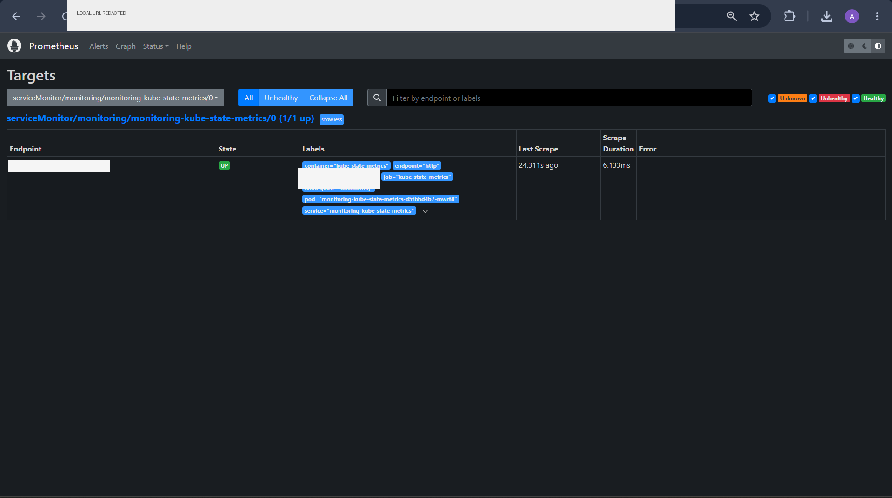
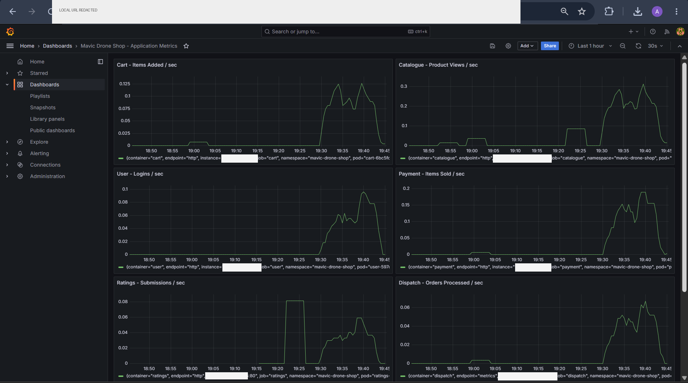
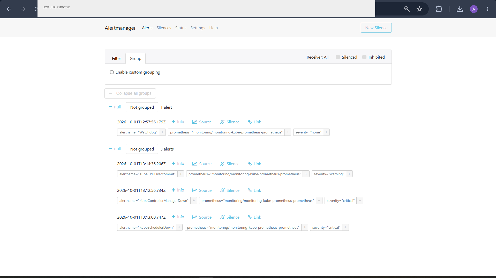

# Observability

The observability layer combines **metrics collection, visualization and alert routing**.

## Components

| Component | Role |
|---|---|
| Prometheus | Metrics collection and querying |
| ServiceMonitor | Kubernetes-native target discovery |
| Grafana | Application/platform visualization |
| Alertmanager | Alert routing and handling |
| `verify-monitoring.sh` | Repeatable monitoring validation |

## Data flow

```text
Service metrics endpoint
        ↓
ServiceMonitor
        ↓
Prometheus
   ┌────┴────┐
   ↓         ↓
Grafana  Alertmanager
```

## Application metrics

The project exposes service-specific application metrics in addition to platform metrics. The exact metric implementation differs by service/runtime.

The repository evidence demonstrates healthy targets for:

- dispatch
- payment
- ratings
- shipping
- user
- web

## Verification

Run:

```bash
./scripts/verify-monitoring.sh
```

Inspect targets directly:

```bash
kubectl get servicemonitor -A
kubectl get pods -A | grep -E 'prometheus|grafana|alertmanager'
```

## Evidence

### Prometheus



### Grafana



### Alertmanager



## Why this matters

A deployment is not considered operationally complete simply because Kubernetes reports a `Running` pod. The monitoring layer provides a second signal: whether the services are actually exposing the expected telemetry and whether the platform can surface that information to an operator.

## Production evolution

A production observability platform would add:

- centralized logs
- long-term metric retention
- SLO/SLI definitions
- actionable alert thresholds
- on-call routing
- distributed tracing
- dashboard ownership and versioning
